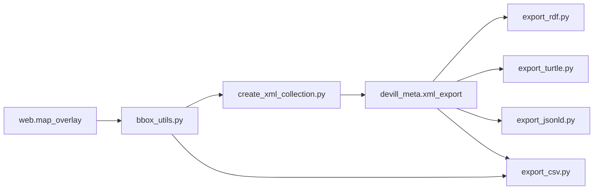

# Requirements

### Overview & Goals
Die Georeferenzierung der Bilddateien (`web.map_overlay`: `image_id`, `bounding_box`) soll in die File-Metadaten (`data/files/file-metadata.csv/.rdf/.ttl/.jsonld`) aufgenommen werden. So lassen sich Bilder räumlich verorten und in GIS oder Web-Maps einblenden.

### Scope
**In Scope**
- CSV: neue Spalten `bounding_box` und `bbox_wkt`.
- RDF/XML, Turtle und JSON-LD: neue Eigenschaft am `edm:ProvidedCHO` mit WKT-Geometrie.
- README: Beschreibung der neuen Felder und der Koordinatenreihenfolge.

**Out of Scope**
- Änderungen an den Objekt-Exporten (`archaeological_objects`, GeoJSON).
- Neue Dateiformate, z. B. ein GeoJSON für Bildflächen.
- Verifikation gegen die Live-DB, soweit sie lokal nicht möglich ist.

### Functional Requirements
- Nur Files mit Eintrag in `web.map_overlay` bekommen Werte. Alle anderen bleiben leer, es gibt keine Zeilenverluste (LEFT JOIN auf `image_id` = File-`id`).
- `bounding_box` in der CSV ist der Originalwert in der Reihenfolge `[[lat,lon],[lat,lon]]` (Northing/Easting).
- `bbox_wkt` ist ein WKT-`POLYGON` in der Reihenfolge `lon lat` (WGS84), damit GIS-Tools es direkt lesen können.
- 2 Ecken (diagonal gegenüberliegend) ergeben ein achsenparalleles Rechteck mit 4 Eckpunkten.
- 3 Ecken ergeben die vierte Ecke als Parallelogramm-Ergänzung, also ein ggf. gedrehtes Rechteck.
- Die RDF-Formate enthalten dieselbe WKT-Geometrie als Literal mit Datentyp `gsp:wktLiteral`.

### Non-Functional Requirements
- Die Pipeline bleibt in `scripts/pipeline.py` unverändert nutzbar.
- Ungültige oder leere `bounding_box`-Werte brechen den Export nicht ab. Sie werden mit einer Warnung übersprungen.

# Technical Design

### Current Implementation
- `scripts/create_xml_collection.py` baut `devill_meta.xml_export` aus `devill_meta.xml_data` (Spalten `id`, `edm`, ...).
- `export_csv.py`, `export_rdf.py`, `export_turtle.py` und `export_jsonld.py` lesen `SELECT ... edm FROM devill_meta.xml_export`.
- `export_csv.py` hat feste Spalten (`csv_headers`). Turtle und JSON-LD iterieren generisch über die Kinder von `ProvidedCHO`, kennen aber nur die fest eingetragenen Namespaces. Sie behandeln weder `rdf:datatype` noch fremde Prefixe.

### Key Decisions
1. **Einmal zentral ins EDM-XML einfügen** (in `create_xml_collection.py`), statt in jedem Exporter einzeln. Alle RDF-Formate bekommen die Daten dadurch konsistent.
2. **Modellierung:** `dcat:bbox` am `edm:ProvidedCHO` mit `rdf:datatype=gsp:wktLiteral` und einem WKT-`POLYGON`.
   - Nicht `dcterms:spatial`, denn das trägt bereits Ortsnamen und füllt die CSV-Spalte `spatial`.
   - EDM kennt keine Bounding-Box-Eigenschaft. `dcat:bbox` ist ein etablierter Standard dafür, und WKT ist GIS-kompatibel.
3. **Gemeinsames Hilfsmodul** `scripts/bbox_utils.py` für Parsing und Geometrieaufbau, damit Logik und Reihenfolge `lat,lon` → `lon lat` nur einmal existieren.
4. **CSV** liest `web.map_overlay` über dasselbe Hilfsmodul und hat zwei Spalten: das Original `bounding_box` für Nachvollziehbarkeit und `bbox_wkt` für GIS.
5. **Einfügen per String-Ersetzung vor `</edm:ProvidedCHO>`** (das Element trägt seine eigenen `xmlns`-Deklarationen), nicht per ElementTree-Neuserialisierung. Das ändert sonst nichts am bestehenden XML.

### Data Models / Contracts
```python

# scripts/bbox_utils.py

def parse_bounding_box(raw) -> list[tuple[float,float]] | None:
    """JSON-Text/Liste [[lat,lon],...] -> [(lat,lon),...]; None bei Fehler."""

def bbox_to_wkt(corners) -> str | None:
    """2 Ecken: Rechteck aus min/max; 3 Ecken: 4. Ecke = A + C - B.
    Ausgabe: POLYGON((lon lat, ..., erster Punkt wiederholt))."""

def load_bounding_boxes(cur) -> dict[int, dict]:
    """SELECT image_id, bounding_box FROM web.map_overlay
    -> {image_id: {'raw': str, 'wkt': str}}"""
```

EDM-Zusatz im XML:
```xml
<dcat:bbox rdf:datatype="http://www.opengis.net/ont/geosparql#wktLiteral"
  xmlns:dcat="http://www.w3.org/ns/dcat#">POLYGON((16.87628 48.71443, ...))</dcat:bbox>
```

### Proposed Changes
- `scripts/bbox_utils.py` (neu): Parsing, Validierung und Aufbau des WKT-Polygons wie oben.
- `scripts/create_xml_collection.py`: Nach dem `CREATE TABLE` werden die Boxen geladen und pro `id` das `dcat:bbox`-Element in `edm` eingefügt (`UPDATE devill_meta.xml_export SET edm = ...::xml`), dann Commit.
- `scripts/export_rdf.py`: `xmlns:dcat` und `xmlns:gsp` im Header ergänzen, `ET.register_namespace` für beide.
- `scripts/export_turtle.py`:
  - Prefixe `dcat:` und `gsp:` ergänzen.
  - `ns_map` erweitern.
  - `rdf:datatype` auswerten und als `"..."^^<datatype>` ausgeben.
- `scripts/export_jsonld.py`:
  - Context und `ns` um `dcat` und `gsp` erweitern.
  - Bei `rdf:datatype` `{"@value":..., "@type":...}` schreiben.
- `scripts/export_csv.py`: `csv_headers` um `bounding_box` und `bbox_wkt` erweitern und die Werte aus `load_bounding_boxes(cur)` per `db_id` füllen.
- `README.md`: Zeilen in der CSV-Strukturtabelle der File-Metadaten, Hinweis zu `dcat:bbox` in den RDF-Formaten, Namespaces `dcat` und `gsp` in der Tabelle der Namespaces.

### Architecture Diagram


### Risks
- **Spaltentyp unbekannt:** Ob `bounding_box` `text`, `json` oder `jsonb` ist, steht nicht fest. `parse_bounding_box` akzeptiert deshalb String und bereits geparste Listen. Die Spaltennamen `image_id` und `bounding_box` stammen aus deiner Angabe und sind vor der Umsetzung gegen die DB zu bestätigen.
- **Reihenfolge der 3 Ecken:** Sie ist nicht dokumentiert. Die Formel A + C − B gilt nur, wenn B die mittlere Ecke ist. Alle 21 Beispiele haben nur 2 Ecken. Bei 3 Ecken sollte die Annahme mit dir geklärt oder im README dokumentiert werden.
- **Koordinatenreihenfolge:** Die Quelle ist `lat,lon`, WKT und GeoJSON erwarten `lon lat`. Das wird im Hilfsmodul zentral getauscht und im README erklärt.
- **Ids:** `image_id` muss den File-ids in `xml_export` entsprechen. Das wird mit LEFT JOIN geprüft, nicht vorausgesetzt.
- **Turtle/JSON-LD:** Beide verarbeiten bisher keine Datentypen. Die Änderung ist klein, aber regressionsrelevant für bestehende Literale.

# Testing

### Validation Approach
- Die Live-DB steht lokal evtl. nicht zur Verfügung. Deshalb werden `bbox_utils.py` und die Serialisierung mit den 21 Beispielwerten aus der Aufgabe in einem kleinen Ad-hoc-Skript geprüft.

### Key Scenarios
- `[[49.99747,14.99328],[49.998,14.99246]]` ergibt `POLYGON((14.99246 49.99747, 14.99328 49.99747, 14.99328 49.998, 14.99246 49.998, 14.99246 49.99747))` oder eine äquivalente geschlossene Ringfolge.
- Ein XML-Schnipsel mit `dcat:bbox` ergibt in Turtle `"POLYGON(...)"^^<http://www.opengis.net/ont/geosparql#wktLiteral>`.
- Dasselbe Snippet ergibt in JSON-LD `{"@value":..., "@type":...}`.
- Dasselbe Snippet bleibt in RDF/XML wohlgeformt.

### Edge Cases
- Leere oder ungültige `bounding_box` wird übersprungen.
- Eine einzelne Ecke wird übersprungen.
- 3 Ecken ergeben ein Parallelogramm.
- Files ohne Overlay behalten leere CSV-Spalten und unverändertes RDF.
- Leerzeichen in den Zahlen wie in `[[48.71443, 16.87628],...]` werden korrekt geparst.
- Python-Syntaxprüfung der geänderten Skripte per `python -m py_compile`.

# Delivery Steps

### ✓ Step 1: Hilfsmodul bbox_utils für Parsing und WKT-Aufbau
`scripts/bbox_utils.py` wandelt `bounding_box`-Werte aus `web.map_overlay` in ein WKT-Polygon um.

- `parse_bounding_box` akzeptiert String/JSON/Liste mit 2 oder 3 Ecken, toleriert Leerzeichen und gibt bei Fehlern `None` zurück.
- `bbox_to_wkt` tauscht `lat,lon` zu `lon lat`. Bei 2 Ecken baut es ein achsenparalleles Rechteck, bei 3 Ecken ergänzt es die vierte Ecke (A + C − B). Der Ring wird geschlossen.
- `load_bounding_boxes(cur)` liefert `{image_id: {raw, wkt}}` aus `web.map_overlay`.
- Prüfung mit den 21 Beispielwerten per Ad-hoc-Skript und `py_compile`.

### ✓ Step 2: Bounding Box ins EDM-XML und in RDF/XML, Turtle und JSON-LD übernehmen
Alle drei RDF-Formate enthalten `dcat:bbox` als `gsp:wktLiteral` für Files mit Overlay.

- `create_xml_collection.py`: Nach `CREATE TABLE` das `dcat:bbox`-Element per String-Ersetzung vor `</edm:ProvidedCHO>` einfügen (`UPDATE ... SET edm`), danach Commit.
- `export_rdf.py`: Namespaces `dcat` und `gsp` im Header und in `register_namespace` ergänzen.
- `export_turtle.py`: Prefixe und `ns_map` erweitern und `rdf:datatype` als `^^<...>` ausgeben.
- `export_jsonld.py`: Context und `ns` erweitern und bei `rdf:datatype` `@value`/`@type` setzen.
- Mit einem Test-XML-Schnipsel die Ausgabe der Serialisierungslogik prüfen, auch bei Literalen ohne Datentyp als Regressionstest.

### ✓ Step 3: CSV-Spalten bounding_box und bbox_wkt ergänzen
`file-metadata.csv` hat die neuen Spalten, die für Files ohne Overlay leer bleiben.

- `export_csv.py`: `csv_headers` um `bounding_box` (Original `[[lat,lon],...]`) und `bbox_wkt` erweitern.
- Werte über `load_bounding_boxes(cur)` anhand der File-`id` setzen.
- Fehlende oder ungültige Werte führen nicht zum Abbruch.

### ✓ Step 4: README dokumentieren
Die README beschreibt die neuen Felder und Formate.

- Neue Zeilen `bounding_box` und `bbox_wkt` in der CSV-Strukturtabelle der File-Metadaten, mit Hinweis auf die Reihenfolge `lat,lon` vs. `lon lat`.
- Hinweis auf `dcat:bbox` in den RDF-Formaten und auf den Umgang mit 2 und 3 Ecken.
- Namespaces `dcat` und `gsp` in der Tabelle der Namespaces ergänzen.