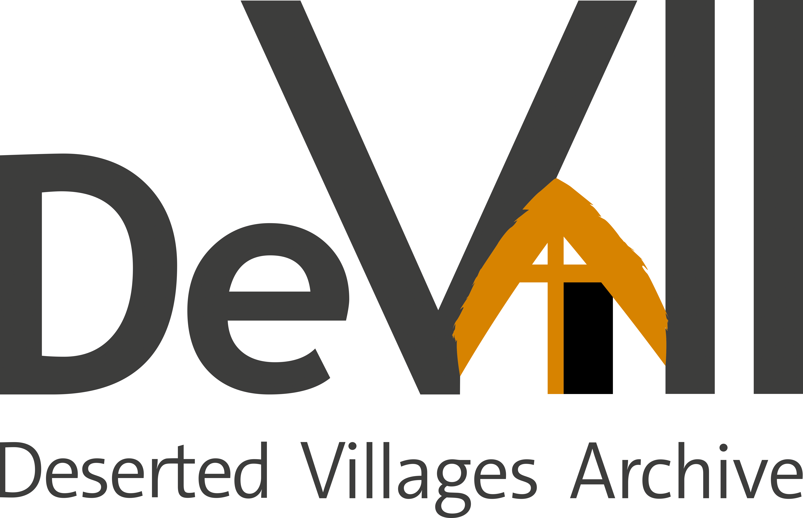
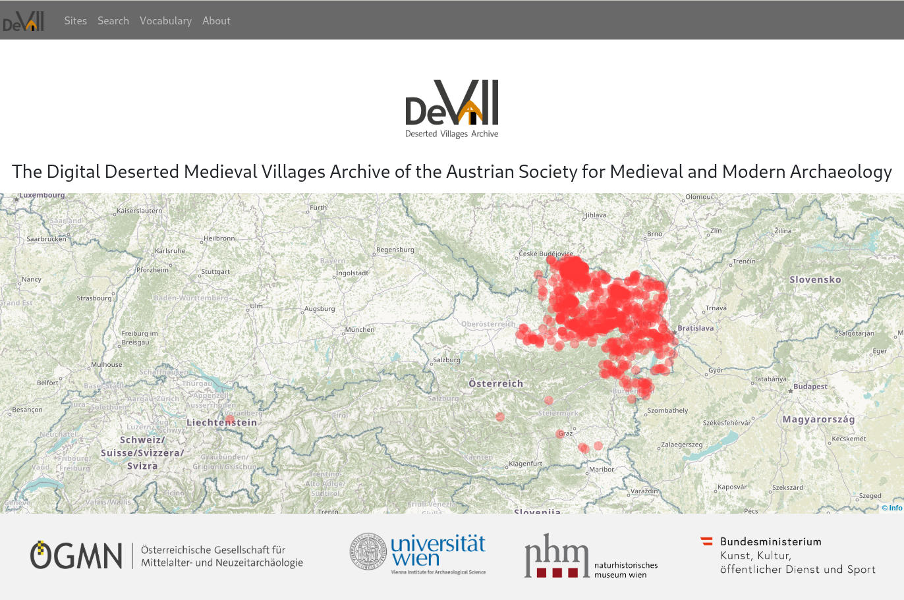
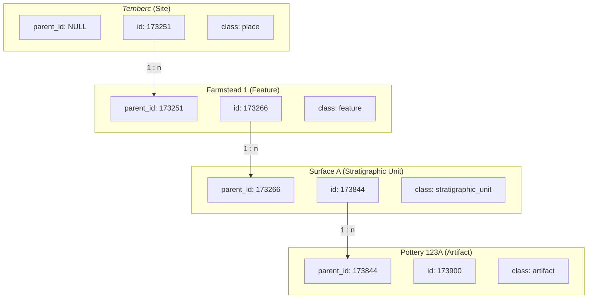
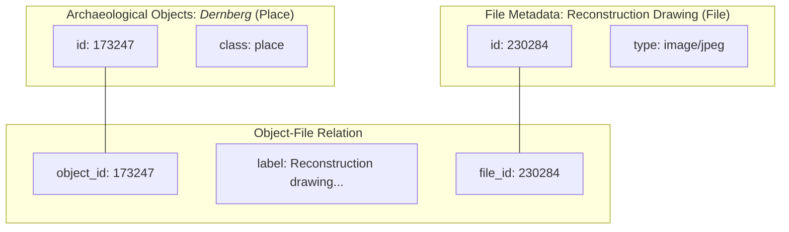

<p align="center">
  <br>
</p>


# DeVill - The Digital Deserted Medieval Villages Archive of the Austrian Society for Medieval and Modern Archaeology. 
## Metadata Dataset of Archaeological Objects and Archive Files


[](#)
[](https://creativecommons.org/licenses/by/4.0/)
[](#)
[](https://doi.org/10.5281/zenodo.22672084)

**Authors:**   
*[Filzwieser, Roland](https://orcid.org/0000-0002-5523-9524) [](https://orcid.org/0000-0002-5523-9524);*
*[Scharrer-Liška, Gabriele](https://orcid.org/0000-0002-1106-9666) [](https://orcid.org/0000-0002-1106-9666);*
*[Eichert, Stefan](https://orcid.org/0000-0002-5827-0797) [](https://orcid.org/0000-0002-5827-0797);*
*[Kühtreiber, Karin](https://orcid.org/0009-0005-7551-0958) [](https://orcid.org/0009-0005-7551-0958);*
*[Huber, Jacqueline](https://orcid.org/0009-0007-7416-3119) [](https://orcid.org/0009-0007-7416-3119);*
*[Siegmeth, Nora](https://orcid.org/0009-0002-7423-4179) [](https://orcid.org/0009-0002-7423-4179);*
*[Koschiček-Krombholz, Bernhard](https://orcid.org/0000-0001-7608-7446) [](https://orcid.org/0000-0001-7608-7446);*
*[Kühtreiber, Thomas](https://orcid.org/0000-0001-8338-668X) [](https://orcid.org/0000-0001-8338-668X);*


## Table of Contents

- [Overview](#overview)
  - [Web Portal](#web-portal)
  - [Context](#context)
  - [Spatial Coverage](#spatial-coverage)
  - [Temporal Coverage](#temporal-coverage)
- [Data Acquisition & Methods](#data-acquisition--methods)
  - [Steps](#steps)
  - [Quality Control](#quality-control)
- [Reuse Potential](#reuse-potential)
- [Acknowledgments](#acknowledgments)
- [Funding Statement](#funding-statement)
- [Dataset Description](#dataset-description)
  - [1. Archaeological Objects](#1-archaeological-objects)
    - [Temporal Concept](#temporal-concept)
    - [CSV Structure (Archaeological Objects)](#csv-structure-archaeological-objects)
    - [Machine Readable Formats (Archaeological Objects)](#machine-readable-formats-archaeological-objects)
      - [Ontologies & Namespaces](#ontologies--namespaces)
      - [Controlled Vocabularies](#controlled-vocabularies)
  - [2. File Metadata](#2-file-metadata)
    - [CSV Structure (File Metadata)](#csv-structure-file-metadata)
    - [Machine Readable Formats (File Metadata)](#machine-readable-formats-file-metadata)
  - [3. Object-File Relations](#3-object-file-relations)
    - [Example Data Relations](#example-data-relations)
    - [CSV Structure (Object-File Relations)](#csv-structure-object-file-relations)
- [Installation & Setup](install.md)
- [Project Structure](#project-structure)
- [References and Related Publications](#references-and-related-publications)
- [License](#license)


## Overview

DeVill provides open online access to the digitised deserted villages archive of the ÖGMN. The data aggregates legacy 
documentation created since the early 1970s (literature excerpts, written sources, photographs, site sketches) together
with newly created digital outputs (georeferenced sketches, vector geometries, find catalogues, and 3D terrain models).
In this repository, the metadata of the project is made available in human- and machine-readable formats.
In addition to the tabular CSV format, the file metadata is available in semantic graph formats to ensure full compatibility with international metadata standards and digital archive aggregators.


### Web Portal

The project is accessible via a dedicated interactive web portal: **[https://devill.oegmn.or.at](https://devill.oegmn.or.at)**.


*Figure 1: Screenshot of the interactive DeVill web portal.*

### Context
DeVill digitised and structurally harmonised the long-running analogue deserted villages archive, formerly part of the Archive for Medieval Archaeology established in 1970/71. The archive was built up under Fritz Felgenhauer and later curated and expanded by the geographer Kurt Bors. As of August 2026, the archive records **2,612 sites** and related evidence. The 2023–2024 project aimed to secure this legacy archive through high-resolution digitisation, to normalise and interlink metadata following [CIDOC CRM](https://www.cidoc-crm.org/) principles, and to publish the results via a searchable catalogue and interactive map.

### Spatial Coverage

The dataset primarily covers **Lower Austria**, but also includes sites in the Austrian states of **Burgenland, Upper Austria, Styria, and Vorarlberg**.

- **Northern boundary:** 48.97595
- **Southern boundary:** 46.83630
- **Eastern boundary:** 17.09513
- **Western boundary:** 9.69079

```geojson
{
  "type": "Feature",
  "geometry": {
    "type": "Polygon",
    "coordinates": [
      [
        [9.69079, 48.97595],
        [17.09513, 48.97595],
        [17.09513, 46.83630],
        [9.69079, 46.83630],
        [9.69079, 48.97595]
      ]
    ]
  },
  "properties": {
    "name": "DeVill Project Spatial Coverage (Bounding Box)"
  }
}
```
*Map 1: GeoJSON definition of the project's spatial coverage (bounding box).*

### Temporal Coverage
The dataset covers the period from **AD 750–1950**, with a primary focus on medieval and early modern deserted settlements (c. AD 750–1700). Archival documentation within the dataset was created between 1971 and 2026.

## Data Acquisition & Methods

### Steps
1. **Inventory & Selection:** Comprehensive capture of the ÖGMN deserted villages archive, prioritising unique site files and sketches with spatial information.
2. **Digitisation:** 
   - Text documents: Fujitsu SV600 overhead scanner with OCR.
   - Large-format maps: Nikon D300 DSLR (35mm lens).
   - Negatives/Slides: Epson Perfection 4870 Photo (1200 dpi).
   - Surface pottery finds: Laser Aided Profiler (LAP) for profile drawings.
3. **Data Modelling:** Curation in [OpenAtlas](https://openatlas.eu) using [CIDOC CRM](https://www.cidoc-crm.org/)-aligned semantic modelling and controlled vocabularies.
4. **GIS Processing:** Georeferencing of archival sketches in QGIS 3.34 using the Freehand Raster Georeferencer. Spatial geometries are stored in PostGIS.
5. **Publication:** Dissemination via an interactive online web application [DeVill](https://devill.oegmn.or.at) with 
persistent landing pages. Furthermore via machine-readable exports (JSON-LD, RDF, CSV) through a documented [API](https://demo.openatlas.eu/swagger/) 
and via metadata following the Europeana Data Model (EDM) and digital objects aggregated by [Kulturpool](https://kulturpool.at/suche?refinementList=dataProvider%255B0%255D=%25C3%2596sterreichische%2520Gesellschaft%2520f%25C3%25BCr%2520Mittelalter-%2520und%2520Neuzeitarch%25C3%25A4ologie).

### Quality Control
- **OCR Validation:** Spot-checking of searchable text.
- **Controlled Vocabularies:** Use of thesauri for site types, sources, and chronology.
- **Geospatial Plausibility:** Geometry validation and comparison against historical cadastral sheets.
- **Integrity Checks:** Automated validation via OpenAtlas entity relations and export scripts.


## Reuse Potential

DeVill can be reused for comparative analyses of medieval/early modern settlement dynamics, deserted village distributions, and landscape change in Austria. The [CIDOC CRM](https://www.cidoc-crm.org/)-aligned structure and machine-readable exports facilitate aggregation with other archaeological and historical datasets. The georeferenced sketches and geometries support GIS-based modelling and verification of newly detected sites. The dataset is also suitable for teaching (data modelling, GIS workflows) and local heritage enquiries.


## Acknowledgments

We acknowledge the foundational work of Fritz Felgenhauer and the decades-long curation and field documentation by Kurt Bors. We thank the many collaborators and volunteers who contributed to the archive, the Natural History Museum Vienna for technical hosting within the OpenAtlas ecosystem, and Kulturpool for aggregating DeVill digital objects.


## Funding Statement

This work was funded by the Austrian Federal Ministry for Arts, Culture, Civil Service and Sport (BMKÖS) through the '[Kulturerbe Digital](https://www.bmwkms.gv.at/themen/kunst-und-kultur/schwerpunkte/digitalisierung/foerderprogramm-kulturerbe-digital.html)' programme (Recovery and Resilience Plan; EU funding '[NextGenerationEU](https://next-generation-eu.europa.eu/)'): GZ: 2023-0.257.819.


## Dataset Description

The dataset presented here provides both human- and machine-readable metadata for the archive. It consists of
two main components: first, a list of deserted village sites and their archaeologically relevant components
(such as features, stratigraphic units, and finds); and second, a list of associated files and their metadata.
These two components are linked (n:n) via their IDs in a cross-referencing table.


### 1. Archaeological Objects
Detailed information about deserted medieval villages and related archaeological sites, including:
- **Spatial Data:** Point coordinates (WGS84) and where applicable polygon or linestring geometries.
- **Spatial quality:** Due to the heterogeneous legacy documentation, spatial precision varies. The digitised archive 
therefore applies a concept that assumes 100% certainty of the localisation but allows for varying precision. 
It distinguishes three cases: (1) a point that lies within the site and represents its central location, (2) a polygon 
representing the area within which the site is definitely located, and (3) a polygon representing the precise extent of the site.
- **Temporal Data:** Dating information is recorded as time spans for the beginning and the end of an entity. This makes it possible to express uncertain or vague dating as well as *termini post*, *ante* and *ad/a quo/ab quo* without losing information (see [Temporal Concept](#temporal-concept)).
- **Descriptive Metadata:** Detailed descriptions of the sites, including historical context and sources.
- **Classification:** Categorisation based on the OpenAtlas type system (e.g., Abandoned Village, Fortification). 
The categories are taken from the [DeVill Vocabulary](https://devill.oegmn.or.at/vocabulary/). In addition to their 
textual labels, their URLs and machine-readable identifiers are included in the machine-readable files.  
- **Identifiers:** Internal IDs and links to the official DeVill and Thanados endpoints.
- **Relations:** IDs of parent entities that represent the site's hierarchical structure on four levels: 
Site/Place, Feature, Stratigraphic Unit and Find.


*Figure 2: Example hierarchical structure of archaeological objects (Place > Feature > Stratigraphic Unit > Artifact).*

#### Temporal Concept
Each entity can have up to four dates (`begin_from`, `begin_to`, `end_from`, `end_to`), following the [OpenAtlas date model](https://redmine.openatlas.eu/projects/uni/wiki/Expanded_dates). Which of the fields are filled determines the meaning of the dating:

| Dating information | Meaning | Filled fields | Example |
| :--- | :--- | :--- | :--- |
| *Terminus post quem* | Earliest possible boundary: the event happened **after** this date. | Only `begin_from` (for a beginning) or only `end_from` (for an end). | **Begin:** A coin minted in AD 1250 is found in the construction layer of a farmstead: the building cannot have been erected before then (`begin_from = 1250-01-01`). <br> **End:** A tax register of 1520 still lists the farmstead as inhabited: it cannot have been abandoned before then (`end_from = 1520-01-01`). |
| *Terminus ante quem* | Latest possible boundary: the event happened **before** this date. | Only `begin_to` (for a beginning) or only `end_to` (for an end). | **Begin:** A village is mentioned for the first time in a charter of 12 March 1190: it must have existed by then (`begin_to = 1190-03-12`). <br> **End:** A cadastral map of 1823 shows the former village area as ploughland: the village must have been deserted before then (`end_to = 1823-01-01`). |
| *Terminus ad quem / a quo / ab quo* | A fixed point or period at which something begins or ends: the exact window is known. | `begin_from` and `begin_to`, or `end_from` and `end_to`. | **Begin:** A church is consecrated between 1 May and 30 June 1275: it was completed within this window (`begin_from = 1275-05-01`, `begin_to = 1275-06-30`). <br> **End:** A written source reports that the village was destroyed in a feud between June and August 1446 (`end_from = 1446-06-01`, `end_to = 1446-08-31`). |

In OpenAtlas the dates are stored as timestamps in the fields `begin_from`, `begin_to`, `end_from` and `end_to`.

This concept is inspired by the temporal model of [GeoJSON-T](https://github.com/kgeographer/geojson-t), which describes 
the `start` and the `end` of a `when` timespan, each with an `earliest` and a `latest` value. Accordingly, `begin_from` 
and `begin_to` correspond to the earliest and latest possible beginning, and `end_from` and `end_to` to the earliest and
latest possible end.

A similar approach is used in CIDOC CRM-based [Linked Art](https://linked.art/api/1.0/shared/timespan/), whose `TimeSpan` 
describes both the beginning and the end by a lower and an upper boundary: `begin_of_the_begin` and `end_of_the_begin` 
for the beginning, and `begin_of_the_end` and `end_of_the_end` for the end. These correspond to `begin_from`, `begin_to`
, `end_from` and `end_to` respectively.

In CIDOC CRM terms, each of these four dates stored in the OpenAtlas database is expressed as an `E61 Time Primitive`. 
The dates belong to a temporal entity (`E2 Temporal Entity`) that represents either the beginning or the end of the 
archaeological object; the earliest and latest possible values of that beginning or end are the two dates of the 
respective pair (`begin_from`/`begin_to` or `end_from`/`end_to`). The temporal entity is linked via `P4 has time span` to 
an `E52 Time-Span`, which in turn points via `P81 ongoing throughout` to the `E61 Time Primitive`. In the OpenAtlas 
database, the value of the time primitive is stored as a PostgreSQL timestamp.

```
E2 Temporal Entity
  └─ P4 has time span ──────────▶ E52 Time-Span
                                    └─ P81 ongoing throughout ──▶ E61 Time Primitive
```

In the CSV files, dates are reduced to years CE.

#### CSV Structure (Archaeological Objects)
The file `data/archaeological_objects/archaeological_objects.csv` contains the following fields:

| Column | Description | Example |
| :--- | :--- | :--- |
| `parent_id` | Identifier of the parent entity (if applicable). | |
| `name` | Name of the archaeological object or site. An asterisk appended to a site name (e.g. Trennau*) indicates a modern working title assigned to an archaeologically identified settlement that cannot be securely linked to a historically attested place name. | `Dernberg Castle` |
| `id` | Unique identifier for the object (OpenAtlas based). | `173247` |
| `type` | Specific type of the object. | `Abandoned Fortification` |
| `path` | Full hierarchy path of the object type. | `Place > Military Facility...` |
| `description` | Detailed historical description and sources. | `In 1208 Hadmar v. Kuenring...` |
| `begin_from` | Earliest possible beginning of the entity's time-span (year CE)| `1200` |
| `begin_to` | Latest possible beginning of the entity's time-span (year CE)| `1208` |
| `end_from` | Earliest possible end of the entity's time-span (year CE). | `1300` |
| `end_to` | Latest possible end of the entity's time-span (year CE). | `1321` |
| `class` | Broad classification (e.g., place). | `place` |
| `geojson` | GeoJSON representation of the geometry. | `{"type":"Point","coordinates":[16.177, 48.617]}` |
| `wkt` | Well-Known Text (WKT) representation of the geometry. | `POINT(16.177 48.617)` |
| `geometry_quality` | Quality of the localisation: `centerpoint` is a single point recorded as the location of the site; `area` is an area within which the site has been located; `shape` is a polygon that marks the physical extent of the site. | `centerpoint`, `area`, `shape` |
| `lon` / `lat` | Longitude and latitude coordinates (WGS84). | `16.1779` / `48.6177` |
| `devill_endpoint` | URL to the object in the DeVill archive. | `https://devill.oegmn.or.at/entity/173247` |
| `api_endpoint` | Link to the OpenAtlas API record for this object. | `https://thanados.openatlas.eu/api/entity/173247` |

#### Machine Readable Formats (Archaeological Objects)

To facilitate seamless data integration, interoperability, and long-term digital preservation, the archaeological object dataset is provided in several standardized, machine-readable formats:

- **RDF/XML (`.rdf`):** A formal Linked Data representation based on the [Linked Art](https://linked.art) profile for cultural heritage.
- **JSON-LD (`.jsonld`):** A JSON-based format for Linked Data, optimized for easy integration into modern web applications and APIs.
- **Turtle (`.ttl`):** A concise, human-readable RDF syntax that simplifies the inspection and manual editing of semantic relationships.
- **GeoJSON (`.geojson`):** A geographic data format containing all archaeological objects classified as `place` that possess spatial geometries, facilitating GIS integration and web mapping.

While the CSV version is primarily designed for human review and basic tabular analysis, the RDF, JSON-LD, and Turtle exports provide a rich, graph-based representation of the data. These formats include granular semantic metadata and complex relationships—such as links to external authorities and specific CIDOC CRM mappings—that are not captured in the simplified CSV structure.


##### Ontologies & Namespaces
The semantic data (RDF, Turtle, JSON-LD) is modelled according to the **[CIDOC Conceptual Reference Model (CRM)](https://www.cidoc-crm.org/)** and the **[Linked Art](https://linked.art/)** profile. The following namespaces are used:

| Prefix | Namespace URI | Description |
| :--- | :--- | :--- |
| `crm` | `http://www.cidoc-crm.org/cidoc-crm/` | CIDOC Conceptual Reference Model (ISO 21127) |
| `la` | `https://linked.art/ns/terms/` | Linked Art profile for cultural heritage |
| `dc` | `http://purl.org/dc/elements/1.1/` | Dublin Core Metadata Element Set |
| `dcterms` | `http://purl.org/dc/terms/` | Dublin Core Metadata Terms |
| `rdf` | `http://www.w3.org/1999/02/22-rdf-syntax-ns#` | Resource Description Framework |
| `rdfs` | `http://www.w3.org/2000/01/rdf-schema#` | RDF Schema |
| `dcat` | `http://www.w3.org/ns/dcat#` | Data Catalog Vocabulary (`dcat:bbox` in the file metadata) |
| `gsp` | `http://www.opengis.net/ont/geosparql#` | GeoSPARQL (datatype `gsp:wktLiteral` for WKT geometries) |

##### Controlled Vocabularies
To ensure semantic interoperability, the dataset links to established controlled vocabularies and authorities:
- **[Getty Art & Architecture Thesaurus (AAT)](https://www.getty.edu/research/tools/vocabularies/aat/):** Used for classifying object types, materials, and techniques (e.g., `aat:300033618` for paintings).
- **[Wikidata](https://www.wikidata.org/):** Used for linking to global entities and providing multilingual labels.
- **[GeoNames](https://www.geonames.org/):** Used for spatial referencing and administrative units.

All formats are located in the `data/archaeological_objects/` directory.


### 2. File Metadata
Metadata for documents, sketches, photos, and drawings associated with the project:
- **Dublin Core / EDM compatible:** Titles, descriptions (English/German), subjects, and creators.
- **Rights & Provenance:** Information on data providers and usage rights.
- **Linked Data:** References to the physical files (PDF, SVG, etc.) and API endpoints.

#### CSV Structure (File Metadata)
The file `data/files/file-metadata.csv` contains the following fields:

| Column | Description | Example |
| :--- | :--- | :--- |
| `id` | Unique identifier for the metadata record (OpenAtlas based). | `235849` |
| `title` | Title of the file. | `2074-10b_wolfeswerde_ker_02` |
| `description_en` / `description_de` | Detailed description of the file's content in both languages. | `foto and drawing jug...` / `Foto und Profilzeichnung...` |
| `subjects` | Keywords and subjects related to the file. | `Jug \| earthenware \| mica...` |
| `spatial` | Spatial coverage or location information. | `2074-10b_wolfeswerde_ker_02` |
| `temporal` | Temporal coverage or dating information. | `1300-1500 \| Late Middle Ages` |
| `created` | The creation date of the original file or the date it was recorded. | `2024-09-03` |
| `filetype` | The file extension or general type (e.g., `pdf`, `svg`). | `svg` |
| `mimetype` | The internet media type of the file (e.g., `application/pdf`, `image/svg+xml`). | `image/svg+xml` |
| `rights` | Usage rights and license information (e.g., Creative Commons). | `Österreichische Gesellschaft...` |
| `data_provider` | The institution providing the data (e.g., ÖGMN). | `Österreichische Gesellschaft...` |
| `is_shown_at` | URL to the digital object in its original context (DeVill/OpenAtlas API). | `https://devill.oegmn.or.at/file/235849.svg` |
| `is_shown_by` | Direct link to the digital file (e.g., PDF/SVG file). | `https://thanados.openatlas.eu/api/display/235849` |
| `bounding_box` | Georeferenced corners of the image (only for files with a map overlay), as recorded in the source data: JSON list of 2 or 3 corners in the order `[latitude, longitude]` (northing/easting). The format follows Leaflet: with 2 corners the points are diagonally opposite corners (south-west/north-east) as used for [`L.imageOverlay`](https://leafletjs.com/reference.html#imageoverlay); with 3 corners the points are `[topleft, topright, bottomleft]` as used for [`leaflet.imageoverlay.rotated`](https://github.com/IvanSanchez/Leaflet.ImageOverlay.Rotated). | `[[49.99747,14.99328],[49.998,14.99246]]` |
| `bbox_wkt` | The image extent as a closed WKT `POLYGON` (WGS84) in the order `longitude latitude`, ready for GIS tools. 2 corners result in an axis-aligned rectangle; 3 corners are completed to a (possibly rotated) rectangle by adding the fourth corner `bottomright = topright + bottomleft − topleft` (calculated in Web Mercator, as Leaflet does). The ring is oriented counterclockwise. | `POLYGON((14.99246 49.99747, 14.99328 49.99747, 14.99328 49.998, 14.99246 49.998, 14.99246 49.99747))` |

The columns `bounding_box` and `bbox_wkt` are empty for files without a georeferenced overlay. Entries with invalid values are skipped during export.


#### Machine Readable Formats (File Metadata)

In addition to the tabular CSV format, the file metadata is available in semantic graph formats to ensure full compatibility with international metadata standards and digital archive aggregators:

-   **[RDF/XML (`.rdf`)](data/files/file-metadata.rdf):** A semantic representation following the **[Europeana Data Model (EDM)](https://europeana.atlassian.net/wiki/spaces/EF/pages/2916974597/Europeana+Data+Model)** and Dublin Core standards, facilitating integration into large-scale cultural heritage platforms.
-   **[JSON-LD (`.jsonld`)](data/files/file-metadata.jsonld):** A developer-friendly Linked Data format that maps file properties and their relationships to archaeological objects in a structured JSON syntax.
-   **[Turtle (`.ttl`)](data/files/file-metadata.ttl):** A human-readable serialization of the metadata triples, providing an easy-to-inspect overview of the semantic links and property assignments.
-   **[GeoJSON (`.geojson`)](data/files/file-metadata.geojson):** A `FeatureCollection` containing all georeferenced files (those with a bounding box). Each feature is the image extent as a `Polygon` (WGS84, order `longitude, latitude`) with the properties `title`, `description_de`, `description_en`, `created`, `is_shown_at`, `is_shown_by`, `api_endpoint` and the original `bounding_box`. Files without a bounding box are not included.

While the CSV file is ideal for quick filtering and overview, these formats provide the necessary technical depth for automated processing and Linked Open Data (LOD) publishing. They include direct references to the digital assets (`isShownBy`) and their landing pages (`isShownAt`), maintaining a persistent link between metadata and the actual digital objects.

For georeferenced images, the RDF/XML, Turtle and JSON-LD files additionally contain the property `dcat:bbox` on the `edm:ProvidedCHO`. Its value is the WKT polygon of the image extent (order `longitude latitude`) with the datatype `gsp:wktLiteral`, identical to `bbox_wkt` in the CSV file. Images with 2 corners are described by an axis-aligned rectangle; for images with 3 corners (`topleft`, `topright`, `bottomleft`) the fourth corner is derived (`bottomright = topright + bottomleft − topleft`), which can result in a rotated rectangle.

All formats are located in the `data/files/` directory.


### 3. Object-File Relations
Links between archaeological objects and the associated files:
- **Mapping:** Connects file IDs to the specific archaeological sites they document.
- **Labels:** Provides descriptive labels for the relationship.

#### Example Data Relations


*Figure 3: Example of relations between an archaeological object and a file metadata record.*

#### CSV Structure (Object-File Relations)
The file `data/crossrefs/object_file_relation.csv` contains the following fields:

| Column | Description | Example |
| :--- | :--- | :--- |
| `file_id` | Identifier of the file (matches `id` in file metadata). | `198570` |
| `filename` | The filename of the associated digital object. | `198570.png` |
| `file_label` | Descriptive label for the file in the context of the object. | `Dernberg Chugelfeld Dornfeld Karte` |
| `object_id` | Identifier of the archaeological object (matches `id` in objects). | `173247` |
| `object_name` | Name of the associated archaeological object. | `Dernberg Castle` |


## Project Structure

- `data/`: Contains the exported metadata.
  - `archaeological_objects/`: Datasets for the found objects in all formats.
  - `files/`: Metadata for the associated media files.
  - `crossrefs/`: Object-file relations between different entities.
- `scripts/`: Python scripts for extraction and processing (see [install.md](install.md) for details.)
- `config/`: Configuration templates (see [install.md](install.md) for details.).


## References and Related Publications

The following publications document the development, research history, technical basis, and archaeological application of DeVill. A more comprehensive bibliography is provided in the associated data paper.

1. Filzwieser, R., Scharrer-Liška, G., Eichert, S., Kühtreiber, T., Kühtreiber, K., Huber, J. and Siegmeth, N. 2024. [Digitising the Deserted Medieval Villages Archive of the Austrian Society for Medieval and Modern Archaeology: The ‘DeVill’ Project](https://archaeopresspublishing.com/ojs/index.php/msr/article/view/2716). *Medieval Settlement Research* 39: 93–97.

2. Scharrer-Liška, G., Eichert, S. and Filzwieser, R. 2024. Die Entstehung des Wüstungsarchivs der Österreichischen Gesellschaft für Mittelalter- und Neuzeitarchäologie und seine Entwicklung zu DeVill. *Beiträge zur Mittelalter- und Neuzeitarchäologie in Österreich* 40: 184–199.

3. Scharrer-Liška, G., Eichert, S. and Filzwieser, R. 2026. DeVill – die Datenbank mittelalterlicher und frühneuzeitlicher Ortswüstungen in Niederösterreich und anderen Bundesländern. In: Pieler, F. and Rammer, E. (eds), *Beiträge zum Tag der Niederösterreichischen Landesarchäologie 2026*. Veröffentlichungen aus den Landessammlungen Niederösterreich 20. St. Pölten: Land Niederösterreich, pp. 96–104.

4. Eichert, S. 2014. OpenATLAS – An Open Source Database Application for Archaeological, Historical, and Spatial Data. In: *Proceedings of the 18th International Conference on Cultural Heritage and New Technologies 2013 (CHNT 18)*.

5. Eichert, S. 2020. Digital Mapping of Medieval Cemeteries: Case Studies from Austria and Czechia. *Journal on Computing and Cultural Heritage* 14(1): Article 3, 1–15. https://doi.org/10.1145/3406535

6. Filzwieser, R. and Eichert, S. 2020. Towards an Online Database for Archaeological Landscapes. Using the Web Based, Open Source Software OpenAtlas for the Acquisition, Analysis and Dissemination of Archaeological and Historical Data on a Landscape Basis. *Heritage* 3: 1385–1401. https://doi.org/10.3390/heritage3040077


---

## License

This project, including all metadata and documentation in this repository, is licensed under the **[Creative Commons Attribution 4.0 International (CC BY 4.0)](LICENSE)** license.

For digital objects (files) referenced via URLs in the metadata, the license of the original source applies. Please refer to the respective landing pages for specific licensing and usage terms.
